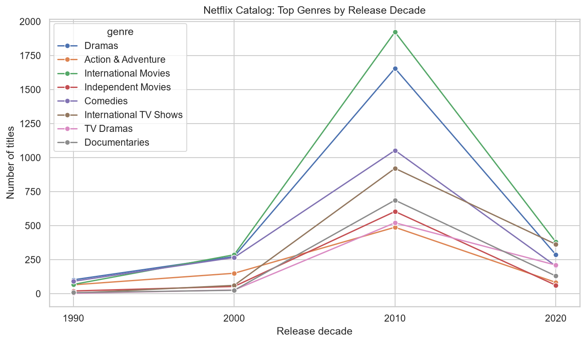
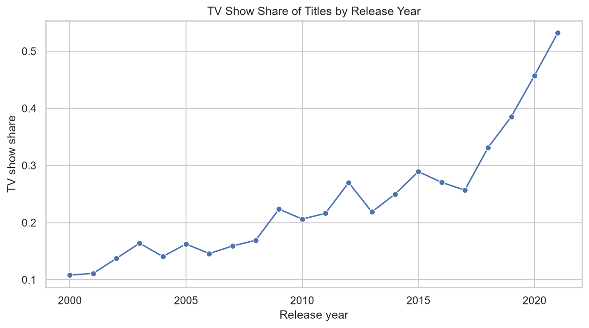
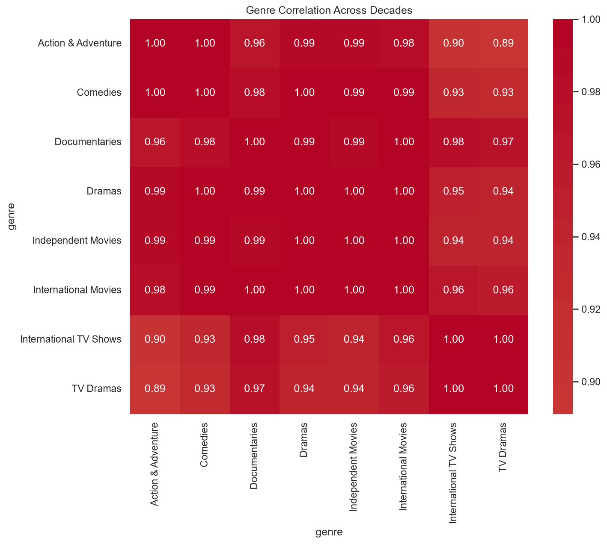

# StreamPulse: Movie & TV Show Content Trends Explorer

An end-to-end data analysis project that explores how Netflix's catalog has changed over time: which genres grew, how the balance between movies and TV shows shifted, and which countries produce the most content. Data is stored in a normalized MySQL database, queried with SQL, and visualized with Python.

## Questions Answered

- How has the mix of genres changed across decades?
- How has the ratio of TV shows to movies changed over time?
- Which countries produce the most titles, and has that changed?
- How has average movie runtime changed by decade?

## Dataset

- **Source:** [Netflix Movies and TV Shows](https://www.kaggle.com/) dataset from Kaggle
- **Size:** 8,807 titles (6,131 movies and 2,676 TV shows)
- **Columns used:** show_id, type, title, country, date_added, release_year, rating, duration, listed_in (genres)
- **Limitation:** This dataset describes what is in the catalog, not how much people watched it. "Genre popularity" here means the number of titles per genre, not viewership.

## Tech Stack

- **Database:** MySQL 8
- **Language:** Python 3
- **Libraries:** Pandas, SQLAlchemy, PyMySQL, Matplotlib, Seaborn
- **Tools:** MySQL Workbench, VS Code, Git

## Database Schema

The raw file stores several genres and countries in one cell (for example "Dramas, International Movies"). I split these into separate tables so they can be joined and aggregated.

| Table | Description | Key |
|---|---|---|
| `titles` | One row per title (type, year, decade, rating, duration) | `show_id` (primary key) |
| `title_genres` | One row per title-genre pair | (`show_id`, `genre`) |
| `title_countries` | One row per title-country pair | (`show_id`, `country`) |

`title_genres` and `title_countries` reference `titles` through a foreign key on `show_id`.

## Project Structure

```
streampulse/
├── data/
│   ├── raw/                 # original Kaggle CSV
│   └── processed/           # cleaned CSVs (generated)
├── sql/
│   ├── 01_schema.sql        # creates the database and tables
│   └── 02_analysis_queries.sql
├── src/
│   ├── explore.py           # inspect the raw data
│   ├── clean_data.py        # clean and split multi-value columns
│   ├── db.py                # database connection
│   ├── load_to_mysql.py     # load CSVs into MySQL
│   └── analysis.py          # run queries and create charts
├── outputs/charts/          # generated charts
├── requirements.txt
└── README.md
```

## How to Run

1. **Clone the repository and open the folder.**

2. **Create and activate a virtual environment, then install libraries:**
```
   python -m venv venv
   venv\Scripts\activate
   pip install -r requirements.txt
```

3. **Download the dataset** from Kaggle and place `netflix_titles.csv` in `data/raw/`.

4. **Clean the data:**
```
   python src/clean_data.py
```

5. **Create the database:** run `sql/01_schema.sql` in MySQL Workbench.

6. **Set your MySQL password:** copy `src/db_example.py` to `src/db.py` and enter your password.

7. **Load the data:**
```
   python src/load_to_mysql.py
```

8. **Run the analysis and generate charts:**
```
   python src/analysis.py
```

## SQL Analysis

The queries in `sql/02_analysis_queries.sql` cover:

- Movies vs TV shows by release year (with TV share)
- Genre counts per decade
- Genre share within each decade, using a window function
- Top producing countries per decade
- Average movie runtime per decade

## Key Findings

> Fill these in using your own query results and charts.

- **Genres:** The most common genre in the [decade] was [genre], making up about [X]% of titles. [Genre] grew from [X] titles in [decade] to [Y] in [decade].
- **Movies vs TV shows:** The TV show share of titles went from about [X]% in [year] to [Y]% in [year].
- **Countries:** [Country] produced the most titles overall, followed by [country] and [country].
- **Runtime:** Average movie length was about [X] minutes in [decade] and [Y] minutes in [decade].

### Charts







## Limitations

- The dataset covers Netflix's catalog only and has no viewership or rating scores, so results describe what was added, not what was watched.
- Titles released before 2000 are few, so percentages for older decades are based on small numbers.
- Titles with several genres or countries are counted once in each, so category counts add up to more than the number of titles.
- About 9% of titles have no country listed and are grouped as "Unknown".

## Future Work

- Add IMDb ratings to measure genre quality or popularity
- Build an interactive dashboard with Streamlit or Power BI
- Track how titles added each year differ from titles released each year